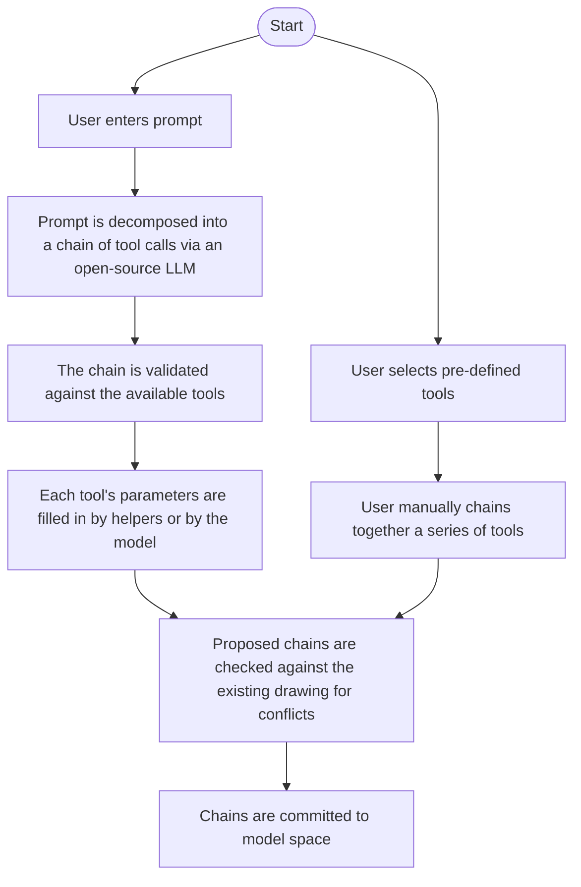

# Civil-3D-CAD-AGENT OVERVIEW
Hello!

This is a project focused on using the Civil 3D .NET API along with python to automate deterministic tasks, build an MCP server for Civil 3D, and to utilize open-source LLMs to create a Civil 3D agentic workflow. The goal for this project is to eliminate redundant tasks within civil engineering plan production (non-design aspects which take an excessive amount of time and are directly impacted from design changes which occur frequently), and to explore the use of open-source LLMs to create streamlined plan production from unseen scenarios. Claude Desktop is used to drive the MCP portion of the workflows, and Qwen2.5-Coder 7B is utilized in the custom prompt window.

The deterministic tasks are usually ones that are repetitive but require the same action to be taken thousands to tens of thousands of times to be accomplished. This usually amounts to the task taking anywhere from hours to days. With the use of Civil 3D's API, many of these deterministic tasks have been cut down to the push of a button, with the greatest success being the creation of grading plan sheets. From my own use, the time spent on grading plan sheets has been cut down from days to minutes. 

The methodology for incorporating open-source LLMs is to try and generalize any outcome in Civil 3D as a chain of both helper functions (Figuring out both where exactly we are in model space and what is around at any point) and basic commands (Such as draw_line, draw_shape, create_layer, and so on). The goal of using these open-sourced models is to generalize chains of CAD commands so that any action can then be decomposed into its components. This idea is analogous to a vector space (Modelspace) in which the basis vectors (Basic CAD operations & helpers) span the entirety of the space. The future goal for this portion of the project is to start collecting enough prompt-to-chain labels so that fine-tuning of these models can achieve better accuracy.

## Some Design Choices
- Models themselves never write code. Only the parameters for the predetermined tools are filled at execution time.
- All models are constrained to only picking from the set of pre-defined tools.
- The tool calls as of now are just tokens (i.e. as of now, making chains of actions is purely done through text and there is no special indexing for what each tool call represents, but that is a consideration for the future)
- Tools made for specific tasks are included in the available list for LLMs to call (i.e. the tools created specifically for grading sheets and other specific tasks are included in what the LLMs can chain together)

## What's here
- HttpBridge.cs, Commands/, PipeInvertSetter/: the C# plugin. A localhost HTTP listener inside Civil 3D, 126 drafting intents, and compute-then-draw handlers for pipe elevations and labels. Every write is one transaction.
- cad_mcp_server.py, drafting_tools.py: the Python MCP server, 167 tools, used by Claude Desktop.
- spatial.py: a grid index of the drawing. Every write is dry-run against it and diffed afterward.
- dashboard/, prompting/: a browser dashboard where blocks are chained by hand or generated from a prompt by a local model.
- finetune/: labelling and fine-tuning pipeline for the prompt-to-chain model.
- package/: installer that ships the plugin, Python, and models.
- redline/: the planner, filler and tool catalog that the prompt block runs on, plus a pipeline that reads reviewer markups from scanned PDFs with a local vision model (Qwen3-VL 4B).
- sheets.py, playbooks.py: sheet cutting from a plan-type spec. The specs themselves are site-specific and not versioned.
- archive/: earlier experiments, the LangGraph prototype and the GNN label-placement work. You chose to keep the folder, so name it, or it looks forgotten.

## Workflow Visualization

## Example
Below is an example of what a section of civil plans might look like that would need driveways:

Using the agent dashboard and the prompt "Draw driveways for the current modelspace", the section of the civil plans were able to have their driveways drawn in the same workflow as seen above (Both the dashboard and the finalized section of the civil plans can be seen below):

## Limitations
The biggest limitations so far is the relatively smaller size of the model that is running behind the custom prompt, and the struggle of figuring out what in modelspace is required to be addressed by the prompt, and where it located. The current workflow works best with prompts that address multiple objects of the same type and leave out ambiguous language (i.e. "Move fire hydrants in the northwestern portion of the plans).
